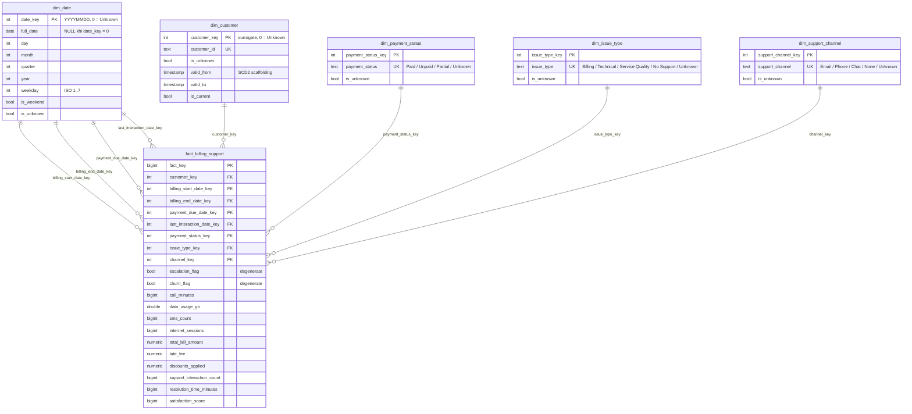

# Medallion Data Warehouse + DSS + OLAP — Telco Customer Churn

Pipeline kho dữ liệu **chạy hoàn toàn cục bộ** (Docker) cho đồ án môn học: biến một file CSV thô về khách hàng viễn thông thành **star schema Kimball** trong PostgreSQL, phủ lên trên là các **data mart**, **materialized view** và **6 truy vấn OLAP** chạy được, rồi nối vào **Metabase** để dựng dashboard DSS.

Kiến trúc **Medallion** (Bronze → Silver → Gold) kết hợp **ETL/ELT lai**: Python chỉ làm Extract + Load + orchestrate, còn **toàn bộ transform nặng chạy bằng SQL bên trong PostgreSQL**.

---

## Mục lục

1. [Kiến trúc](#1-kiến-trúc)
2. [Mô hình ER — Gold star schema](#2-mô-hình-er--gold-star-schema)
3. [Medallion architecture](#3-medallion-architecture)
4. [Kimball star schema](#4-kimball-star-schema)
5. [ETL vs ELT boundary](#5-etl-vs-elt-boundary)
6. [OLAP demonstrations](#6-olap-demonstrations)
7. [Materialized views](#7-materialized-views)
8. [Quickstart](#8-quickstart)
9. [Dataset](#9-dataset)
10. [Định nghĩa KPI](#10-định-nghĩa-kpi)
11. [DSS use cases](#11-dss-use-cases)
12. [Cấu trúc thư mục](#12-cấu-trúc-thư-mục)
13. [Metabase setup](#13-metabase-setup)
14. [Troubleshooting](#14-troubleshooting)
15. [Extensions (future work)](#15-extensions-future-work)

---

## 1. Kiến trúc

```mermaid
flowchart LR
    subgraph SRC["Nguồn"]
        HF["Hugging Face<br/>Omer1234567/telco-churn-synthetic<br/>112.552 dòng × 20 cột"]
    end

    subgraph PY["Python — Extract + Load + Orchestrate"]
        DL["scripts/download_dataset.py<br/>hf_hub_download"]
        BR["src/01_load_bronze.py<br/>pandas → to_sql(append)"]
        RUN["src/02_run_sql.py<br/>thay batch_id, chạy SQL"]
    end

    subgraph PG["PostgreSQL 16 — nơi transform thật sự diễn ra"]
        B[("bronze.bronze_customer_billing<br/>TEXT, append-only")]
        S[("silver.silver_customer_billing<br/>typed, deduped")]
        G[("gold.dim_* / gold.fact_billing_support<br/>star schema")]
        M["gold.mart_* (view)<br/>gold.mv_* (materialized)"]
    end

    subgraph BI["Trình bày"]
        MB["Metabase<br/>:3000"]
        EX["exports/*.csv + *.parquet<br/>Looker Studio / Sheets"]
    end

    HF -->|"E: tải CSV"| DL
    DL -->|"L: pandas"| BR
    BR -->|"E+L: INSERT append"| B
    B -->|"T: ELT — SQL thuần"| S
    S -->|"T: ELT — SQL thuần"| G
    G -->|"ELT: CREATE VIEW / MV"| M
    RUN -.->|"orchestrate"| S
    RUN -.->|"orchestrate"| G
    M --> MB
    M --> EX

    style B fill:#cd7f32,color:#fff
    style S fill:#c0c0c0,color:#000
    style G fill:#ffd700,color:#000
    style PY fill:#e8f4f8
    style PG fill:#f0f0f0
```



**Ranh giới ETL/ELT** (chi tiết ở [mục 5](#5-etl-vs-elt-boundary)):

| Đoạn | Loại | Chạy ở đâu |
|---|---|---|
| CSV → `bronze` | **E + L** | Python (`pandas.read_csv` + `to_sql`) |
| `bronze` → `silver` | **T (ELT)** | SQL trong Postgres |
| `silver` → `gold.dim_*`, `gold.fact_*` | **T (ELT)** | SQL trong Postgres |
| `gold` → `mart_*`, `mv_*` | **ELT** | SQL trong Postgres |

---

## 2. Mô hình ER — Gold star schema



---

## 3. Medallion architecture

| Layer | Schema | Nội dung | Load mode |
|---|---|---|---|
| **Bronze** | `bronze` | CSV thô đúng như khi tải về. **Mọi cột là `TEXT`**, không cast, không clean. Có 3 cột audit: `ingest_batch_id`, `ingest_ts`, `source_file`. | `INSERT` **append-only** — chạy lại chỉ thêm batch mới, không xoá batch cũ |
| **Silver** | `silver` | Đã clean, đúng kiểu (`DATE`, `BIGINT`, `DOUBLE PRECISION`, `NUMERIC(12,2)`, `BOOLEAN`), dedupe theo business key, tên cột conformed. | `INSERT INTO ... SELECT ... FROM bronze` — **ELT trong Postgres** |
| **Gold** | `gold` | Star schema Kimball (`dim_*`, `fact_*`) + data mart (`mart_*`) + materialized view (`mv_*`) | **ELT**: Python chỉ orchestrate, SQL làm hết |

**Vì sao Bronze append-only?** Đây là điểm cốt lõi của medallion: dữ liệu thô là bất biến và có thể replay. Mỗi lần chạy tạo một `ingest_batch_id` mới (độ chính xác microsecond), nên có thể truy vết chính xác dòng nào đến từ lần chạy nào, và rebuild Silver/Gold từ bất kỳ batch nào.

```sql
-- Kiểm chứng: mỗi lần `make bronze` thêm một batch, không mất dữ liệu
SELECT ingest_batch_id, COUNT(*)
FROM bronze.bronze_customer_billing
GROUP BY 1 ORDER BY 1;
```

---

## 4. Kimball star schema

### Grain của fact (tuyên bố tường minh)

> **1 dòng `gold.fact_billing_support` = 1 chu kỳ thanh toán (billing cycle) của 1 khách hàng.**
>
> Business key: `(customer_id, billing_cycle_start)` — được enforce bằng `CONSTRAINT uq_fact_grain UNIQUE (customer_key, billing_start_date_key)`.

### Surrogate keys

Mọi dimension dùng **surrogate key** kiểu `INTEGER GENERATED BY DEFAULT AS IDENTITY`, tách biệt hoàn toàn khỏi natural key:

| Dimension | Surrogate key | Natural key | Số member |
|---|---|---|---|
| `dim_date` | `date_key` (YYYYMMDD) | `full_date` | 1.101 ngày + key 0 |
| `dim_customer` | `customer_key` | `customer_id` | 27.778 + key 0 |
| `dim_payment_status` | `payment_status_key` | `payment_status` | 3 + key 0 |
| `dim_issue_type` | `issue_type_key` | `issue_type` | 4 + key 0 |
| `dim_support_channel` | `support_channel_key` | `support_channel` | 4 + key 0 |

### Conformed dimensions

`dim_date` được dùng chung cho **4 vai trò** (role-playing dimension) trong cùng một fact: `billing_start_date_key`, `billing_end_date_key`, `payment_due_date_key`, `last_interaction_date_key`. Đây là conformed dimension điển hình — một bảng ngày duy nhất phục vụ mọi trục thời gian.

### Unknown member (key = 0)

Mọi dimension đều có dòng `key = 0` với `is_unknown = TRUE`, để fact **không bao giờ** có FK NULL:

```sql
SELECT * FROM gold.dim_date WHERE date_key = 0;
--  date_key | full_date | day | month | quarter | year | weekday | is_weekend | is_unknown
-- ----------+-----------+-----+-------+---------+------+---------+------------+------------
--         0 |           |     |       |         |      |         |            | t
```

`full_date` để **NULL** (không dùng sentinel `1900-01-01`) vì sentinel sẽ âm thầm làm sai mọi predicate dạng `WHERE full_date <= '2023-12-31'`. Có `CHECK (date_key = 0 OR full_date IS NOT NULL)` để bảo vệ.

### "No Support" không phải "Unknown"

Đây là quyết định thiết kế quan trọng. 18.719 dòng (16,6%) không có `primary_issue_type` / `support_channel` — nhưng đó **không phải lỗi dữ liệu**, mà là **trạng thái nghiệp vụ có thật**: khách hàng không liên hệ support trong kỳ đó.

| | `Unknown` (key 0) | `No Support` / `None` |
|---|---|---|
| Ý nghĩa | Không biết giá trị thật (lỗi ETL) | Biết chính xác là "không có" |
| `is_unknown` | `TRUE` | `FALSE` |
| Số dòng fact | **0** (DQ rule DQ-11 enforce) | **18.719** |

Nhờ vậy doanh thu luôn đủ 100%, và nhóm "im lặng" vẫn phân tích được (xem [OLAP-5b](#6-olap-demonstrations)).

### Date hierarchy

`gold.dim_date` khai báo hierarchy `year → quarter → month → day` và có index tương ứng để roll-up/drill-down nhanh:

```sql
CREATE INDEX ix_dim_date_hierarchy ON gold.dim_date (year, quarter, month, day);
```

Range của `dim_date` được **tính động** từ `MIN/MAX` của cả 4 cột date trong Silver, không hardcode — nhờ vậy batch incremental chứa ngày mới sẽ tự mở rộng lịch.

---

## 5. ETL vs ELT boundary

Đây là bảng phân chia trách nhiệm chính thức của pipeline:

| Bước | Loại | Chạy ở đâu | File |
|---|---|---|---|
| CSV → `bronze` | **E + L** | Python (`pandas.read_csv` + `to_sql`) | `src/01_load_bronze.py` |
| `bronze` → `silver` | **T (ELT)** | **SQL trong Postgres** (`INSERT INTO silver ... SELECT ... FROM bronze` với `TO_DATE`, `CAST`, `CASE`, `NULLIF`) | `sql/01_bronze_to_silver.sql` |
| `silver` → `gold.dim_*`, `gold.fact_*` | **T (ELT)** | **SQL trong Postgres** (`INSERT INTO gold.dim_* SELECT ... FROM silver`) | `sql/02_silver_to_gold.sql` |
| `gold` → `mart_*` (view) | **ELT** | SQL `CREATE VIEW` | `sql/03_marts.sql` |
| `gold` → `mv_*` (materialized) | **ELT** | SQL `CREATE MATERIALIZED VIEW` | `sql/04_materialized_views.sql` |

**Vai trò của Python:** tải dataset, load Bronze, thực thi file SQL theo thứ tự, validate, export. **Python không transform dữ liệu theo từng dòng** ngoài lần load Bronze ban đầu.

Kiểm chứng bằng lệnh:

```bash
# Không có pandas transform nào ngoài Bronze load
grep -rn "astype\|apply\|map(" src/*.py | grep -v "01_load_bronze"
# → không có kết quả
```

---

## 6. OLAP demonstrations

File: [`sql/05_olap_demos.sql`](sql/05_olap_demos.sql) — chạy bằng `make olap-demo`.

| # | Thao tác | Mô tả | Kỹ thuật SQL |
|---|---|---|---|
| **OLAP-1** | **ROLL-UP** | Doanh thu theo `year → quarter → month` | `GROUP BY ROLLUP(year, quarter, month)` + `GROUPING()` |
| **OLAP-2** | **DRILL-DOWN** | Từ mức năm xuống mức tháng | `GROUPING SETS ((year), (year, month))` |
| **OLAP-3** | **SLICE** | Cố định 1 chiều: `payment_status = 'Paid'` | `WHERE` trên 1 dimension |
| **OLAP-4** | **DICE** | Lọc 3 chiều: `year = 2022 AND payment_status IN ('Paid','Unpaid') AND issue_type = 'Billing'` | `WHERE` trên nhiều dimension |
| **OLAP-5** | **PIVOT** | Churn rate: `issue_type` (hàng) × `channel` (cột) | Conditional aggregation `AVG(CASE WHEN ... THEN 1.0 ELSE 0 END)` |
| **OLAP-5b** | **Silent churn** | So sánh nhóm không liên hệ support vs có liên hệ | `GROUP BY` trên segment |
| **BONUS** | **CUBE** | Churn rate trên `CUBE(issue_type, channel, payment_status)` | `GROUP BY CUBE(...)` |

### Sample output — ROLL-UP (trích)

```
 year | quarter | month | grouping_level |   level_label    | billing_cycles |  revenue
------+---------+-------+----------------+------------------+----------------+------------
 2020 |       1 |     1 |              0 | month            |          27778 | 2368390.97
 2020 |       1 |     2 |              0 | month            |          20909 | 1778085.26
 2020 |       1 |     3 |              0 | month            |          15693 | 1333757.48
 2020 |       1 |       |              1 | quarter subtotal |          64380 | 5480233.71
 ...
 2020 |         |       |              3 | year subtotal    |         108747 | 9237995.12
 2021 |         |       |              3 | year subtotal    |           3694 |  313228.94
 2022 |         |       |              3 | year subtotal    |            111 |    9596.87
      |         |       |              7 | GRAND TOTAL      |         112552 | 9560820.93
```

`GROUPING()` phân biệt NULL thật với NULL sinh ra bởi subtotal — nếu không có nó, dòng `GRAND TOTAL` sẽ không thể nhận diện.

### Sample output — PIVOT (OLAP-5)

```
   issue_type    | churn_email | churn_phone | churn_chat | billing_cycles
-----------------+-------------+-------------+------------+----------------
 Billing         |       28.05 |       28.21 |      28.12 |          31298
 Service Quality |       27.03 |       28.16 |      27.32 |          31256
 Technical       |       28.63 |       28.62 |      27.57 |          31279
```

### Sample output — Silent churn (OLAP-5b)

```
      segment       | billing_cycles | customers | churned_cycles | churn_rate | avg_csat
--------------------+----------------+-----------+----------------+------------+----------
 Contacted support  |          93833 |     27339 |          26242 |      27.97 |     3.00
 No support contact |          18719 |     11492 |           1535 |       8.20 |     5.00
```

Đây là insight DSS quan trọng nhất của pipeline: nhóm **không liên hệ support** có churn rate chỉ **8,20%**, thấp hơn nhiều so với **27,97%** ở nhóm có liên hệ. Nghĩa là khách rời bỏ **không** phải nhóm phàn nàn nhiều — họ rời đi trong im lặng.

---

## 7. Materialized views

| Materialized view | Grain | Unique index (cho `REFRESH CONCURRENTLY`) | Dashboard dùng |
|---|---|---|---|
| `gold.mv_billing_monthly` | `(year, quarter, month)` | `ux_mv_billing_monthly (year, quarter, month)` | Revenue & Billing |
| `gold.mv_churn_by_issue_channel` | `(issue_type, support_channel)` | `ux_mv_churn_by_issue_channel (issue_type, support_channel)` | Churn Risk |

**Chiến lược refresh:**

```bash
make refresh-mv
# tương đương:
#   REFRESH MATERIALIZED VIEW CONCURRENTLY gold.mv_billing_monthly;
#   REFRESH MATERIALIZED VIEW CONCURRENTLY gold.mv_churn_by_issue_channel;
```

`CONCURRENTLY` yêu cầu **unique index phủ toàn bộ dòng, chỉ dùng tên cột** (không expression, không `WHERE`) — cả 2 MV đều thoả. Nhờ vậy refresh không khoá người đọc, Metabase vẫn query được trong lúc refresh.

`sql/04_materialized_views.sql` kết thúc bằng `REFRESH MATERIALIZED VIEW` (không `CONCURRENTLY`) để `make marts` chạy lại vẫn cập nhật — vì `CREATE MATERIALIZED VIEW IF NOT EXISTS` **không** repopulate MV đã tồn tại.

---

## 8. Quickstart

```bash
# 1. Cài dependencies (tạo .venv, cài requirements.txt, copy .env.example → .env)
make install

# 2. Khởi động Postgres 16 + Metabase
make up

# 3. Chạy toàn bộ pipeline
make all

# 4. Xem 6 truy vấn OLAP
make olap-demo
```

Hoặc gộp:

```bash
make install && make up && make all && make olap-demo
```

**Các target khác:**

| Target | Việc nó làm |
|---|---|
| `make download` | Tải CSV từ Hugging Face → `data/raw/telco_churn.csv` (idempotent) |
| `make profile` | Profile CSV thô → `data/profile.txt` |
| `make bronze` | CSV → `bronze` (append-only) |
| `make silver-gold` | `bronze` → `silver` → `gold` (ELT) |
| `make marts` | Tạo 3 view + 2 materialized view |
| `make refresh-mv` | `REFRESH ... CONCURRENTLY` cả 2 MV |
| `make validate` | 12 DQ rule → `gold.dq_results`, exit non-zero nếu fail |
| `make export` | 11 dataset → CSV + Parquet trong `exports/` |
| `make reset-soft` | `TRUNCATE` bronze/silver/gold, **giữ** container + dashboard |
| `make reset` | `docker compose down -v` — **xoá volume**, mất data + dashboard |
| `make down` | Dừng container, giữ volume |
| `make clean` | Xoá cache Python + file export (giữ CSV) |

> `make reset` **không** xoá `data/raw/telco_churn.csv`. CSV sống sót, nên `make all` sau đó không cần tải lại.

---

## 9. Dataset

| Hạng mục | Giá trị |
|---|---|
| Nguồn | Hugging Face: [`Omer1234567/telco-churn-synthetic`](https://huggingface.co/datasets/Omer1234567/telco-churn-synthetic) |
| File | `synthetic_customer_data_evenly_distributed.csv` |
| Kích thước | 13,43 MB — **112.552 dòng × 20 cột** |
| Khoảng thời gian | 2020-01-01 → 2023-01-05 |
| Số khách hàng | 27.778 |
| Grain | 1 dòng = 1 chu kỳ thanh toán của 1 khách (0 duplicate) |

### 20 cột

| Cột (snake_case) | Kiểu gốc | Ghi chú |
|---|---|---|
| `customer_id` | string | `CUST0000001` … |
| `billing_cycle_start` | date | ISO `YYYY-MM-DD` |
| `billing_cycle_end` | date | |
| `call_minutes` | int | 100–599 |
| `data_usage_gb` | float | 1–100 |
| `sms_count` | int | 0–199 |
| `internet_sessions` | int | 0–99 |
| `total_bill_amount` | float | 20–150 |
| `payment_status` | string | `Paid` / `Unpaid` / `Partial` |
| `payment_due_date` | date | |
| `late_fee` | float | 0–20 |
| `discounts_applied` | float | 0–20 |
| `support_interaction_count` | int | 0–5 |
| `last_interaction_date` | date | **18.719 NULL** |
| `primary_issue_type` | string | `Billing` / `Technical` / `Service Quality` / **18.719 NULL** |
| `resolution_time_minutes` | int | 0–120 |
| `satisfaction_score` | int | 1–5 |
| `escalation_flag` | bool | `True` / `False` |
| `support_channel` | string | `Email` / `Phone` / `Chat` / **18.719 NULL** |
| `has_churned` | bool | `True` / `False` |

### Đặc điểm dữ liệu cần lưu ý

1. **Tên cột gốc là CamelCase không có underscore** (`CustomerID`, `BillingCycleStart`, `DataUsageGB`). Lowercase thuần sẽ cho `customerid` — không khớp SQL. Pipeline dùng `to_snake_case()` trong `src/config.py` để chuyển đúng, kể cả acronym (`DataUsageGB → data_usage_gb`).

2. **18.719 dòng (16,6%) không có support interaction.** Ba cột `last_interaction_date`, `primary_issue_type`, `support_channel` cùng NULL trên đúng nhóm dòng này, và `support_interaction_count = 0` khớp chính xác. Đây là trạng thái nghiệp vụ, không phải lỗi — xem [mục 4](#4-kimball-star-schema).

3. **`satisfaction_score` và `resolution_time_minutes` có sentinel value.** 56.313 dòng có `satisfaction_score = 5` và 21.197 dòng có `resolution_time_minutes = 0` — phần lớn là dòng không có interaction. Nếu tính CSAT trên toàn bộ, kết quả bị thổi lên **3,33** thay vì **3,00** thật; resolution time bị kéo xuống **54,3 phút** thay vì **66,8 phút** thật. Vì vậy `mart_support_monthly` chỉ tính trên `support_interaction_count > 0`.

---

## 10. Định nghĩa KPI

| KPI | Công thức | Cột trong mart | Ghi chú |
|---|---|---|---|
| **Churn rate** | `AVG(CASE WHEN churn_flag THEN 1.0 ELSE 0 END)` | `mart_billing_monthly.churn_rate`, `mart_churn_summary.churn_rate` | **Mức dòng** (tỷ lệ chu kỳ bị đánh dấu churn). Một khách có thể churn ở kỳ này nhưng không ở kỳ khác, nên khác với churn mức khách hàng |
| **Churned customers** | `COUNT(DISTINCT customer_key) FILTER (WHERE churn_flag)` | `mart_churn_summary.churned_customers` | Mức khách hàng, để đối chiếu với churn rate mức dòng |
| **ARPU** | `SUM(total_bill_amount) / COUNT(DISTINCT customer_key)` | `mart_billing_monthly.arpu` | Doanh thu bình quân trên mỗi khách đang hoạt động |
| **Overdue rate** | `100 × COUNT(*) FILTER (WHERE payment_status IN ('Unpaid','Partial')) / COUNT(*)` | `mart_billing_monthly.overdue_rate` | % chu kỳ chưa thanh toán đủ |
| **CSAT** | `AVG(satisfaction_score)` | `mart_support_monthly.csat` | **Chỉ trên dòng có interaction** (`support_interaction_count > 0`) |
| **Escalation rate** | `100 × COUNT(*) FILTER (WHERE escalation_flag) / COUNT(*)` | `mart_support_monthly.escalation_rate` | % ticket bị escalate |
| **Avg resolution time** | `AVG(resolution_time_minutes)` | `mart_support_monthly.avg_resolution_min` | **Chỉ trên dòng có interaction** |
| **Discount ratio** | `SUM(discounts_applied) / SUM(total_bill_amount)` | tính từ `mart_billing_monthly` | Tỷ lệ giảm giá trên doanh thu |
| **No-support customers** | `COUNT(*) FILTER (WHERE support_interaction_count = 0)` | `mart_billing_monthly.no_support_customers` | Khối lượng khách "im lặng" chưa tiếp cận |

---

## 11. DSS use cases

Pipeline này phục vụ 5 quyết định cụ thể:

### 1. Có nên dồn ngân sách giữ chân sang nhóm "im lặng"?

**Dữ liệu:** OLAP-5b cho thấy nhóm không liên hệ support có churn rate **8,20%** (1.535/18.719 chu kỳ), nhóm có liên hệ là **27,97%** (26.242/93.833).

**Quyết định:** Không. Nhóm rời bỏ chủ yếu **không** phải nhóm phàn nàn — họ rời đi mà không nói gì. Chiến dịch giữ chân nên nhắm vào tín hiệu hành vi (giảm `data_usage_gb`, tăng `late_fee`) chứ không phải số lần gọi support.

### 2. Kênh support nào hiệu quả nhất?

**Dữ liệu:** PIVOT cho thấy churn rate gần như phẳng giữa 3 kênh (27,03%–28,63%), nhưng `avg_resolution` khác nhau: Email 64,76–65,31 phút, Phone 64,97–65,16 phút, Chat 64,54–65,47 phút.

**Quyết định:** Không có kênh nào vượt trội về churn. Tối ưu nên tập trung vào **loại vấn đề** thay vì kênh — `Technical` có churn cao nhất ở cả 3 kênh.

### 3. Doanh thu đang tăng hay giảm?

**Dữ liệu:** ROLL-UP cho thấy doanh thu giảm mạnh theo thời gian: 2020 = 9.237.995, 2021 = 313.229, 2022 = 9.597. Số chu kỳ cũng giảm: 108.747 → 3.694 → 111.

**Quyết định:** Đây là **cohort effect** của dataset tổng hợp (khách hàng rời dần theo thời gian), không phải suy giảm kinh doanh thật. Dashboard cần hiển thị **ARPU** thay vì tổng doanh thu để so sánh công bằng giữa các kỳ — ARPU ổn định ~85 qua mọi tháng.

### 4. Tỷ lệ quá hạn thanh toán có đáng lo?

**Dữ liệu:** `overdue_rate` dao động 19,14%–20,21% ở các tháng đầu 2020, ổn định quanh 20%.

**Quyết định:** 20% là mức cao nhưng **ổn định** — không phải vấn đề khẩn cấp. Ưu tiên thấp hơn churn.

### 5. Có nên tăng cường kênh Chat?

**Dữ liệu:** Chat có `avg_resolution` thấp nhất ở 2/3 loại issue (64,54 phút cho Technical, 65,37 cho Service Quality) nhưng churn rate không thấp hơn.

**Quyết định:** Chat nhanh hơn nhưng không giữ chân tốt hơn. Đầu tư vào Chat chỉ hợp lý nếu mục tiêu là **giảm chi phí vận hành**, không phải giảm churn.

---

## 12. Cấu trúc thư mục

```
.
├── docker-compose.yml          # postgres:16 + metabase
├── .env.example                # mẫu cấu hình (copy thành .env)
├── .gitignore
├── requirements.txt            # dependencies pinned
├── Makefile                    # 15 target orchestration
├── README.md
│
├── sql/
│   ├── 00_init_schemas.sql         # CREATE SCHEMA bronze/silver/gold + gold.dq_results
│   ├── 01_bronze_to_silver.sql     # ELT: bronze → silver
│   ├── 02_silver_to_gold.sql       # ELT: silver → dim_* + fact_*
│   ├── 03_marts.sql                # CREATE VIEW mart_*
│   ├── 04_materialized_views.sql   # CREATE MATERIALIZED VIEW mv_*
│   └── 05_olap_demos.sql           # 5 OLAP + CUBE bonus
│
├── src/
│   ├── config.py               # paths, DATABASE_URL, BATCH_ID, to_snake_case()
│   ├── 00_profile.py           # profile CSV thô → data/profile.txt
│   ├── 01_load_bronze.py       # E+L: CSV → bronze (append-only)
│   ├── 02_run_sql.py           # chạy sql/01..02
│   ├── 03_build_marts.py       # chạy sql/03..04
│   ├── 04_validate.py          # 12 DQ rule → gold.dq_results
│   └── 05_export_marts.py      # CSV + Parquet → exports/
│
├── scripts/
│   └── download_dataset.py     # hf_hub_download → data/raw/
│
├── data/                       # gitignored (trừ .gitkeep)
│   ├── raw/telco_churn.csv
│   └── profile.txt
│
└── exports/                    # gitignored (trừ .gitkeep)
    ├── mart_billing_monthly.csv / .parquet
    ├── mart_support_monthly.csv / .parquet
    ├── mart_churn_summary.csv / .parquet
    ├── mv_billing_monthly.csv / .parquet
    ├── mv_churn_by_issue_channel.csv / .parquet
    ├── dim_customer.csv / .parquet
    ├── dim_date.csv / .parquet
    ├── dim_payment_status.csv / .parquet
    ├── dim_issue_type.csv / .parquet
    ├── dim_support_channel.csv / .parquet
    └── fact_billing_support_denormalized.csv / .parquet
```

---

## 13. Metabase setup

### 13.1. Kết nối lần đầu

1. Mở **http://localhost:3000**
2. Hoàn tất wizard admin (email + password tuỳ ý, chỉ lưu cục bộ)
3. **Add database** → **PostgreSQL**:

| Trường | Giá trị |
|---|---|
| Display name | `Warehouse` |
| Host | **`postgres`** ← tên service Docker, **không phải** `localhost` |
| Port | `5432` |
| Database name | `warehouse` |
| Username | `dw` |
| Password | `dw` |

> **Lưu ý:** dùng `localhost` sẽ fail vì Metabase chạy trong container riêng, `localhost` trỏ về chính nó.

### 13.2. Cấu hình drill-down

Metabase chỉ drill-down được trên cột kiểu **DATE/TIMESTAMP**, không drill trên 3 cột INT rời. Vì vậy `mart_billing_monthly` có thêm cột **`month_start DATE`**.

1. **Admin settings → Table metadata → `gold.mart_billing_monthly`**
2. Cột `month_start` → **Type: Creation date** (hoặc bất kỳ date type phù hợp)
3. **Admin settings → Data model → `gold.dim_date`** → đánh dấu là date dimension
4. Trong dashboard, thêm filter theo `month_start` → Metabase tự cho phép drill `Year → Quarter → Month → Day`

### 13.3. Ba dashboard gợi ý

#### Dashboard 1 — Revenue & Billing

Dùng **`gold.mv_billing_monthly`** (materialized, nhanh).

```sql
-- Line chart: total_revenue theo thời gian
SELECT month_start, total_revenue
FROM gold.mv_billing_monthly
ORDER BY month_start;
```

```sql
-- Bar chart: ARPU theo tháng
SELECT month_start, arpu
FROM gold.mv_billing_monthly
ORDER BY month_start;
```

```sql
-- KPI card: overdue_rate tháng gần nhất
SELECT overdue_rate
FROM gold.mv_billing_monthly
ORDER BY month_start DESC
LIMIT 1;
```

#### Dashboard 2 — Support Ops

Dùng **`gold.mart_support_monthly`** (view, cần filter `support_interaction_count > 0` đã có sẵn).

```sql
-- Bar chart: tickets theo kênh
SELECT support_channel, SUM(tickets) AS tickets
FROM gold.mart_support_monthly
GROUP BY support_channel
ORDER BY tickets DESC;
```

```sql
-- Line chart: avg_resolution_min theo thời gian
SELECT month_start, SUM(avg_resolution_min * tickets) / SUM(tickets) AS avg_resolution_min
FROM gold.mart_support_monthly
GROUP BY month_start
ORDER BY month_start;
```

```sql
-- Heatmap: csat theo issue_type × support_channel
SELECT issue_type, support_channel,
       SUM(csat * tickets) / SUM(tickets) AS csat
FROM gold.mart_support_monthly
GROUP BY issue_type, support_channel;
```

```sql
-- KPI card: escalation_rate
SELECT ROUND(100.0 * SUM(escalations) / SUM(tickets), 2) AS escalation_rate
FROM gold.mart_support_monthly;
```

#### Dashboard 3 — Churn Risk

Dùng **`gold.mv_churn_by_issue_channel`** (materialized, nhanh).

```sql
-- Bar chart: churn_rate theo issue_type
SELECT issue_type, SUM(churned_cycles)::numeric / SUM(billing_cycles) * 100 AS churn_rate
FROM gold.mv_churn_by_issue_channel
GROUP BY issue_type
ORDER BY churn_rate DESC;
```

```sql
-- Table: các segment rủi ro cao
SELECT issue_type, support_channel, billing_cycles, churned_cycles, churn_rate, avg_csat
FROM gold.mv_churn_by_issue_channel
WHERE churn_rate > 27
ORDER BY churn_rate DESC;
```

```sql
-- KPI card: churn_rate toàn bộ
SELECT ROUND(100.0 * SUM(churned_cycles) / SUM(billing_cycles), 2) AS churn_rate
FROM gold.mv_churn_by_issue_channel;
```

### 13.4. Dashboard nào dùng materialized view?

| Dashboard | Nguồn | Lý do |
|---|---|---|
| Revenue & Billing | `mv_billing_monthly` | Aggregation nặng trên 112k dòng, đọc nhiều lần |
| Churn Risk | `mv_churn_by_issue_channel` | Join 3 dimension + aggregate, đọc nhiều lần |
| Support Ops | `mart_support_monthly` (view) | Có filter sẵn, cardinality thấp (264 dòng), view đủ nhanh |

---

## 14. Troubleshooting

### Port 5432 hoặc 3000 đã bị chiếm

```bash
# Sửa .env
POSTGRES_PORT=5433
METABASE_PORT=3001
```

Rồi `make down && make up`. Nhớ đổi `DB_PORT` tương ứng nếu chạy script Python từ host.

### Tải dataset từ Hugging Face chậm hoặc fail

```bash
# Kiểm tra kết nối
curl -I https://huggingface.co

# Tải lại với log chi tiết
HF_HUB_VERBOSITY=debug make download

# Nếu đã có file, bỏ qua tải
ls -lh data/raw/telco_churn.csv
```

`download_dataset.py` idempotent: nếu file tồn tại và size > 0, nó skip. Dùng `--force` để tải lại.

### PostgreSQL identifier case sensitivity

PostgreSQL **fold tên identifier không quote về lowercase**. Nếu tạo bảng bằng `CREATE TABLE "MyTable"` (có quote), sau đó query `SELECT * FROM mytable` sẽ fail.

Pipeline này tránh hoàn toàn bằng cách:
- Mọi identifier trong SQL đều **không quote** và **lowercase**
- `to_snake_case()` chuyển `CustomerID → customer_id` **trước khi** ghi vào Bronze

### `pd.read_csv("hf://...")` không hoạt động

Pandas **không** hỗ trợ scheme `hf://` trực tiếp. Phải dùng `hf_hub_download`:

```python
# SAI
df = pd.read_csv("hf://datasets/Omer1234567/telco-churn-synthetic/file.csv")

# ĐÚNG
from huggingface_hub import hf_hub_download
path = hf_hub_download(repo_id="...", filename="...", repo_type="dataset")
df = pd.read_csv(path)
```

### `REFRESH MATERIALIZED VIEW CONCURRENTLY` báo lỗi

Ba nguyên nhân thường gặp:

| Lỗi | Nguyên nhân | Fix |
|---|---|---|
| `cannot refresh materialized view "x" concurrently` | Chưa có UNIQUE index | `CREATE UNIQUE INDEX ... ON mv_x (...)` |
| `cannot execute REFRESH MATERIALIZED VIEW in a transaction block` | Đang trong transaction | Chạy qua `psql` autocommit, không wrap trong `engine.begin()` |
| `materialized view "x" has not been populated` | MV tạo bằng `WITH NO DATA` | `REFRESH MATERIALIZED VIEW x;` (không CONCURRENTLY) trước |

### `TO_DATE` format mismatch

Nếu dataset đổi format ngày, `TO_DATE(col, 'YYYY-MM-DD')` sẽ trả NULL hoặc lỗi. Kiểm tra bằng:

```bash
make profile
grep -A 5 "DATE-LIKE COLUMNS" data/profile.txt
# Xem "unparseable (non-null but invalid)" — phải bằng 0
```

Nếu format khác, sửa `TO_DATE` trong `sql/01_bronze_to_silver.sql` (ví dụ `'DD/MM/YYYY'`).

### `make all` báo lỗi ở bước validate

```bash
# Xem rule nào fail
docker compose exec -T postgres psql -U dw -d warehouse -c \
  "SELECT rule_id, failed_rows, status FROM gold.dq_results ORDER BY run_ts DESC, rule_id LIMIT 12;"
```

Nếu `DQ-10` fail (`dim_date` chỉ có 1 dòng), nghĩa là Silver rỗng — kiểm tra `make bronze` đã chạy chưa.

### Metabase mất dashboard sau `make reset`

`make reset` chạy `docker compose down -v`, xoá **cả** volume `dw_metabase_data`. Dashboard lưu trong H2 nằm ở volume đó.

- Dùng `make down` (không `-v`) để giữ dashboard
- Dùng `make reset-soft` để xoá data nhưng giữ dashboard
- Chỉ dùng `make reset` khi muốn reset hoàn toàn

### `psql: error: sql/xxx.sql: No such file or directory`

`psql` chạy **bên trong container**, không thấy thư mục `sql/` của host. Makefile đã xử lý bằng cách pipe qua stdin:

```makefile
$(PSQL) < sql/00_init_schemas.sql   # đúng
$(PSQL) -f sql/00_init_schemas.sql  # sai
```

---

## 15. Extensions (future work)

### 15.1. Kích hoạt SCD Type 2 cho `dim_customer`

Hiện tại `dim_customer` là **Type 1** (chỉ giữ giá trị mới nhất), nhưng đã có sẵn cột `valid_from`, `valid_to`, `is_current` để nâng cấp:

```sql
-- Khi customer_id đã tồn tại nhưng thuộc tính thay đổi:
UPDATE gold.dim_customer
SET valid_to = NOW(), is_current = FALSE
WHERE customer_id = :id AND is_current = TRUE;

INSERT INTO gold.dim_customer (customer_id, valid_from, is_current)
VALUES (:id, NOW(), TRUE);
```

Cần thêm thuộc tính mô tả khách hàng (segment, tenure, region) vào dataset — hiện tại dataset chỉ có `customer_id`, nên SCD2 chưa có gì để track.

### 15.2. Mô hình dự đoán churn

Với 112.552 dòng và 10 measure, có thể train model phân loại:

```python
# Feature: call_minutes, data_usage_gb, sms_count, internet_sessions,
#          total_bill_amount, late_fee, discounts_applied,
#          support_interaction_count, resolution_time_minutes, satisfaction_score
# Target: churn_flag
```

Lưu ý: `churn_flag` là cờ **mức dòng**, không phải mức khách hàng. Cần aggregate về mức khách trước khi train nếu muốn dự đoán "khách này có rời bỏ không".

### 15.3. Incremental Bronze loading

Hiện tại `make bronze` load **toàn bộ** CSV mỗi lần. Với dataset lớn hơn, có thể:

1. Thêm cột `file_hash` (SHA256) vào Bronze
2. Skip nếu hash đã tồn tại
3. Hoặc dùng `ingest_ts` + watermark để chỉ load dòng mới

### 15.4. Orchestration nâng cao

Makefile đủ cho đồ án, nhưng production cần:
- **Airflow / Dagster** cho DAG scheduling
- **dbt** cho transformation layer có test + lineage
- **Great Expectations** cho DQ thay vì 12 rule thủ công

### 15.5. Các phân tích bổ sung

- **Cohort retention**: nhóm khách theo tháng đầu tiên, track retention theo thời gian
- **RFM segmentation**: Recency / Frequency / Monetary từ `fact_billing_support`
- **Churn prediction dashboard**: kết hợp model score vào `dim_customer`

---

## License & ghi chú

Đồ án môn học. Dataset là dữ liệu tổng hợp (synthetic) từ Hugging Face, không chứa thông tin cá nhân thật.
